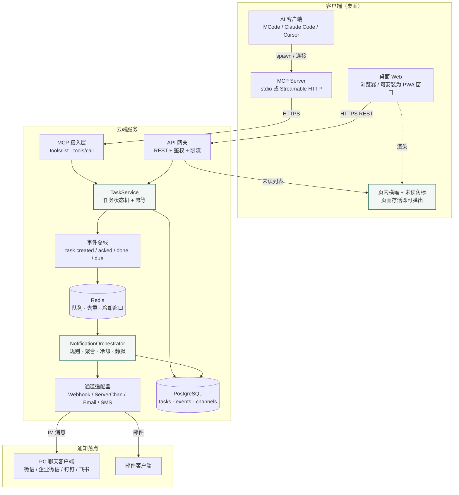
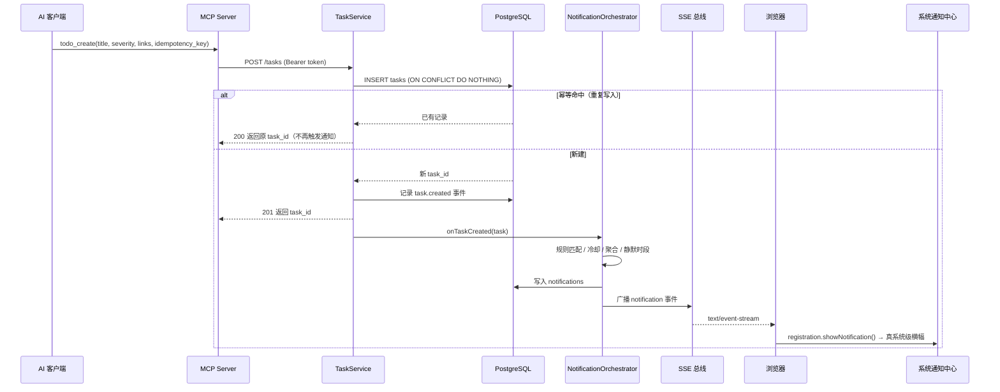
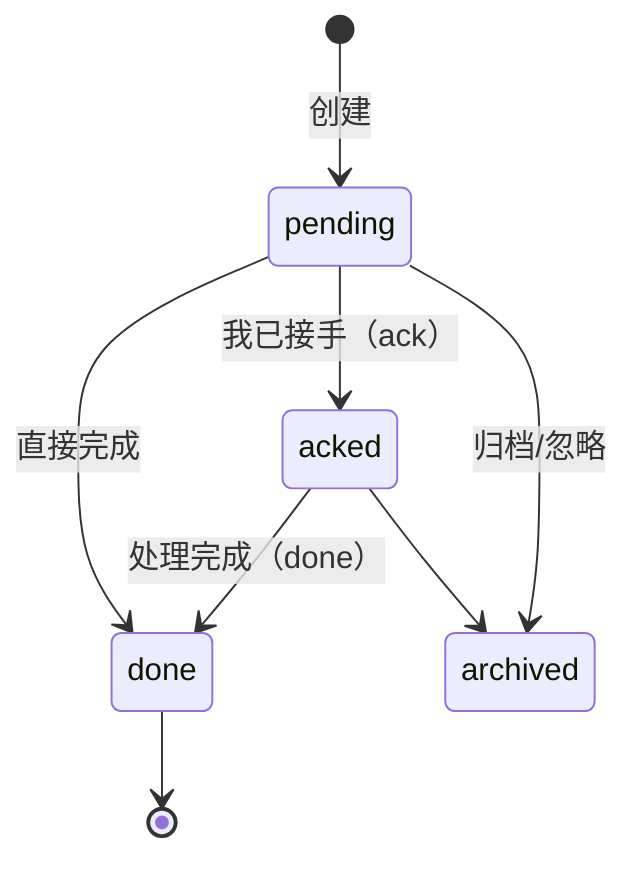

# AI Todo 服务 · 技术方案

> 目标：AI 通过 MCP 把「已完成、需要我关注」的事项推进 Todo；服务在满足规则时提醒到桌面；我在桌面上查看与处置。

- 版本：v0.12（配置 A + 账号体系已实现；修复通知聚合跨账号串台与聚合窗口崩溃；补齐两级删除与批量清空通路；补齐 Docker Compose 双形态部署；附录 A 记录实现现状）
- 日期：2026-10-28
- 变更：
  - **v0.3** 范围收敛为纯桌面端，移除 Web Push / Bark / 全部移动端
  - **v0.4** 明确「浏览器能发真系统级通知」这一基座事实，通知方案拆为 **配置 A（纯 Web，零外部依赖）** 与 **配置 B（纯 Web + 一条外部兜底）**；新增 §8.5「浏览器通知能力的准确边界」——Chrome 后台节流与冻结机制、Service Worker 唤醒条件、正确实现代码与 Chrome 白名单设置
  - **v0.5** 配置 A 落地后的回写：§2.1 主链路改为配置 A 实际形态（无队列、SSE 直出）、§4.2 工具补 `todo_archive`、§4.6 客户端配置改零配置写法、§5 REST 补 archive 与 `/stream`、§6.1/§6.2 节流策略改为「首条即时 + 尾部合并」、§10.1 技术栈落为 PGlite + 无队列；新增**附录 A · 实现现状**
  - **v0.6** 账号体系：§3.1 `users` 表补 `username`/`password_hash`/`is_admin`/`is_active`；§5 REST 补账号与令牌管理端点；§9 鉴权改为「账号 / 访问令牌 / 会话」三层模型；§4.1 MCP 约束改为**凭证必须来自环境变量**（不再有服务端文件兜底）；新增 §9.2 账号管理与用户隔离
  - **v0.7** 收尾复核：§5 补查询参数 / 路径参数 / 空 body 的白名单与错误契约；§9.4 服务端磁盘凭据文件清单（含 v1 遗留 `data/user-token.txt` 的吊销与删除）；附录 A.2 补三个「客户端输入错误冒泡成 500」的缺陷及修法
  - **v0.8** 账号可见性：§8.1 顶栏新增常驻「当前用户」入口（头像 + 用户名 + 下拉菜单：账号信息 / 账号与令牌 / 退出登录）；**退出登录改为真的吊销服务端会话**；Service Worker 静态资源由 cache-first 改 network-first（消除「刷新一次还是旧界面」）
- 关联文档：[形态选型调研](./form-factor-research.html)

---

## 0. 关键前提（已与需求方确认）

| 前提 | 说明 | 对设计的影响 |
|---|---|---|
| **MCP 只负责写入，不负责通知** | AI 通过 MCP 写任务；由服务端在任务创建后自行触发通知 | 通知入口是「任务事件」而非「MCP 调用」。任何来源的任务（MCP / 手动加 / Webhook 推入）走同一套通知规则，行为一致 |
| **全云端部署** | 任务数据存云端，客户端一律走 HTTPS | 不需要本机 daemon，也就没有本地 SQLite 与本地系统 Toast（代价见 §8.2） |
| **只做桌面端，移动端推迟** | 不做手机 PWA、不做微信小程序、不做原生 App | 移除全部浏览器推送基础设施（VAPID、订阅管理、推送轮换），通知出口从「手机」改为「PC 上的聊天客户端 / 邮件 / 页内横幅」 |
| **可靠性地基是「未读列表」，不是推送** | 推送只是加速器 | 桌面端只有一个出口，错过推送就是彻底错过。因此**服务端必须永久保留未处理任务**，任何时候打开页面都能看到全部待办；推送失败不构成数据丢失 |
| **通知方案是可切换的两档** | 配置 A：纯 Web，浏览器系统横幅 + 未读列表，零外部依赖；配置 B：在此之上加一条外部通道（邮件 / 群机器人 / Server酱） | 通道层做成可插拔。配置 A 下 `channels` 表、通道适配器、凭据管理与通道自检**可以整体不落地**；两档之间切换不改动数据模型、不返工 |

---

## 1. 设计目标与非目标

### 目标

1. **单一数据源**：任务只存一处，桌面各浏览器读写同一份，不存在同步/冲突问题。
2. **写入与通知解耦**：MCP 侧是纯粹的写入端点；通知由服务端事件编排按规则触发。
3. **通知可插拔**：新增一个通道不改主流程；单通道故障不影响其他通道。
4. **不打扰**：AI 频繁写任务会淹掉通知，必须有分级、聚合、冷却、静默时段。
5. **不漏**：推送只是加速器，**未读列表永远是完整且可追溯的**。
6. **可溯源**：每条任务能回溯到「哪个 AI、哪个会话、产出了什么」。
7. **幂等**：AI 工具调用重试不能产生重复任务与重复通知。

### 非目标（v1 明确不做）

- **一切移动端**：手机 PWA、微信小程序、原生 App、App Store / 应用商店分发
- 多租户 SaaS 化（组织、团队、成员邀请、配额与计费）——只做「账号之间互相隔离」这一层
- 完整的项目管理能力（甘特图、依赖、看板拖拽）—— 只做「待我关注」这一类
- 离线编辑与冲突合并（全云端，弱网下以重试为准）
- 浏览器级推送（Web Push / VAPID）—— 桌面端在国内 Chrome/Edge 走 FCM 不通，且移动端推迟后它已无价值
- 桌面真正可靠的后台系统横幅（需本地进程或扩展，见 §8.2 与 §8.3）

---

## 2. 总体架构



**读图要点**：通知有三个落点，但**没有一个是必须依赖的**。真正保证「不漏」的是 `tasks` 表——不管哪条通道是否送达，未处理的任务都躺在服务端，任何时候打开页面都完整可见。配置 A 只保留「页内横幅 + 未读列表」两个落点，`CH`（通道适配器）与 `sinks` 整层都可以不落地。

### 2.1 请求主链路（写入 → 提醒）



**关键点**：MCP 调用在 `TaskService` 返回时即结束，通知是**异步**的。AI 端不感知推送结果，也不需要等待。

> **配置 A 的实现形态**：没有消息队列。`TaskService` 写入成功后直接进程内调用 `onTaskCreated`，编排完立刻经 SSE 总线广播。推送失败不重试——因为「推送是加速器，未读列表才是地基」，任务永远留在 `pending` 里，用户打开页面一定看得到。
> **配置 B** 只需在 `NO` 与投递之间插入队列 + 通道适配器，规则匹配、聚合、冷却、静默时段这一整层**完全不变**。

---

## 3. 数据模型

### 3.1 枚举与表结构（PostgreSQL）

```sql
create extension if not exists pgcrypto;

create type task_status   as enum ('pending', 'acked', 'done', 'archived');
create type task_severity as enum ('info', 'need_human', 'blocker');
-- 配置 A（纯 Web）不建 channels 表；配置 B 启用 webhook / email / serverchan；
-- sms 为 blocker 备用；webpush / bark / jpush 随移动端或原生端一起推迟（v3），
-- 先留枚举位省去后续迁移。
create type channel_type  as enum ('webhook', 'email', 'serverchan', 'sms',
                                   'webpush', 'bark', 'jpush');
create type notif_status  as enum ('queued', 'sent', 'failed', 'skipped', 'expired');

-- 账号（人登录 Web 界面用）。密码用 scrypt 加盐哈希，明文不落库。
create table users (
  id           uuid primary key default gen_random_uuid(),
  username     text unique,              -- 小写归一化；空=尚未开通账号
  email        text unique,
  display_name text,
  password_hash text,                   -- scrypt$N$r$p$salt$key
  is_admin     boolean not null default false,
  is_active    boolean not null default true,
  created_at   timestamptz not null default now()
);
create unique index users_username_uq on users (username) where username is not null;

-- AI 来源：溯源与聚合的维度
create table ai_sources (
  id          uuid primary key default gen_random_uuid(),
  user_id     uuid not null references users(id) on delete cascade,
  agent       text not null,              -- MCode / Claude Code / Cursor ...
  session_key text not null,              -- 客户端提供的会话标识
  label       text,                       -- 人类可读，如「重构登录模块」
  created_at  timestamptz not null default now(),
  unique (user_id, session_key)
);

-- 任务
create table tasks (
  id               uuid primary key default gen_random_uuid(),
  user_id          uuid not null references users(id) on delete cascade,
  title            text not null,
  detail           text,
  status           task_status   not null default 'pending',
  severity         task_severity not null default 'need_human',
  project          text,
  links            jsonb not null default '[]'::jsonb,  -- [{label,url}]
  source_id        uuid references ai_sources(id) on delete set null,
  idempotency_key  text,
  notify_requested boolean not null default true,
  due_at           timestamptz,          -- 到点提醒（v2 启用）
  created_at       timestamptz not null default now(),
  updated_at       timestamptz not null default now(),
  acked_at         timestamptz,
  done_at          timestamptz
);

-- 幂等：AI 重试不产生重复任务
create unique index tasks_idem_uq on tasks (user_id, idempotency_key)
  where idempotency_key is not null;
create index tasks_list_idx   on tasks (user_id, status, created_at desc);
create index tasks_proj_idx   on tasks (user_id, project, status);
create index tasks_source_idx on tasks (source_id);

-- 事件流：所有状态变更，落库用于编排与审计
create table task_events (
  id         bigserial primary key,
  user_id    uuid not null references users(id) on delete cascade,
  task_id    uuid references tasks(id) on delete cascade,
  type       text not null,   -- task.created | task.acked | task.done | task.due | task.archived
  payload    jsonb not null default '{}'::jsonb,
  created_at timestamptz not null default now()
);
create index events_pending_idx on task_events (type, id);

-- 通知通道订阅（仅配置 B 需要；配置 A 纯 Web 可整表不建）
create table channels (
  id         uuid primary key default gen_random_uuid(),
  user_id    uuid not null references users(id) on delete cascade,
  type       channel_type not null,
  label      text,
  target     jsonb not null default '{}'::jsonb,  -- {webhook_url} | {sendkey} | {email} | {phone}
  priority   int  not null default 100,           -- 数字小者优先
  enabled    boolean not null default true,
  quota      jsonb not null default '{}'::jsonb,   -- 通道配额，如 {"daily_left":3}
  last_error text,
  last_ok_at timestamptz,
  created_at timestamptz not null default now()
);
create index channels_user_idx on channels (user_id, enabled, priority);

-- 通知投递记录
create table notifications (
  id               uuid primary key default gen_random_uuid(),
  user_id          uuid not null references users(id) on delete cascade,
  task_id          uuid references tasks(id) on delete cascade,
  channel_id       uuid references channels(id) on delete set null,
  channel_type     channel_type not null,
  status           notif_status not null default 'queued',
  provider_msg_id  text,
  error            text,
  attempts         int not null default 0,
  next_retry_at    timestamptz,
  sent_at          timestamptz,
  read_at          timestamptz,
  created_at       timestamptz not null default now()
);
create index notif_task_idx  on notifications (task_id, created_at desc);
create index notif_retry_idx on notifications (status, next_retry_at)
  where status in ('queued', 'failed');

-- 通知规则（每用户一行）
create table notification_rules (
  user_id      uuid primary key references users(id) on delete cascade,
  min_severity task_severity not null default 'need_human',
  channels     jsonb not null default '[]'::jsonb,  -- 通道 id 或 type 列表，空=全部
  quiet_hours  jsonb,        -- {"start":"23:00","end":"08:00","tz":"Asia/Shanghai"}
  cooldown_sec int  not null default 300,
  group_by     text not null default 'source_session', -- source_session | project | none
  digest_hour  int,          -- 每日摘要推送时刻（本地小时），null=不发
  updated_at   timestamptz not null default now()
);

-- API Token（MCP 与脚本用）
create table api_tokens (
  id           uuid primary key default gen_random_uuid(),
  user_id      uuid not null references users(id) on delete cascade,
  name         text not null,
  token_hash   text not null unique,      -- 只存哈希
  scopes       text[] not null default '{tasks:read,tasks:write}',
  created_at   timestamptz not null default now(),
  last_used_at timestamptz,
  revoked_at   timestamptz
);
```

> v0.2 中的 `push_subscriptions` 表已随 Web Push 一并移除；若 v3 恢复移动端，该表与 `channel_type='webpush'` 一起加回。

### 3.2 任务状态机



- 只有 `pending` 且 `severity >= min_severity` 且 `notify_requested = true` 的任务会触发通知。
- `ack` 表示「我知道了，我来处理」——**它是推送的去重闸门**：ack 后不再重复提醒。

### 3.3 幂等语义

`idempotency_key` 由 MCP Server 自动生成，推荐格式：

```
{agent}:{session_key}:{client_generated_task_ref}
```

- 服务端对 `(user_id, idempotency_key)` 建唯一索引。
- 命中冲突时 **返回已有 task（HTTP 200），不产生新事件、不重复通知**。
- AI 侧即使不传 key，MCP Server 也会基于「本会话 + 标题哈希 + 时间窗」生成兜底 key，降低重复风险（但不保证）。

### 3.4 未读任务是长期资产

`status='pending'` 的任务**不设过期时间**，永久保留直到用户 ack / done / archive。提供 `GET /api/v1/tasks?status=pending` 作为「我还有多少没看」的权威答案，不依赖任何推送送达状态。

---

## 4. MCP 接口设计

### 4.1 传输选型

| 场景 | 传输 | 说明 |
|---|---|---|
| v1 主用 | **stdio** | MCP Server 作为本地子进程，由 AI 客户端 spawn。无需 OAuth、凭据走环境变量，最省事。stdout 严格留给协议，日志一律走 stderr |
| v2 备选 | **Streamable HTTP** | 需要「任意客户端填 URL 就能接入」时启用。按 2026-07-28 规范为**无状态**实现（无 `Mcp-Session-Id`，协议版本与客户端信息走 `_meta`，方法/工具名走 `Mcp-Method` / `Mcp-Name` 路由头），鉴权用 OAuth 2.1 Bearer |

> 老的 HTTP+SSE 传输已于 2025-03-26 废弃，不新建。
> 同一个 Server 实现可同时暴露 stdio 与 HTTP 两个入口。

### 4.2 工具清单

| 工具 | 用途 | 触发通知 |
|---|---|---|
| `todo_create` | 创建任务（AI 推进的主入口） | 是（受规则约束） |
| `todo_list` | 查询任务 | 否 |
| `todo_update` | 修改任务字段 | 仅当状态回到 pending 时 |
| `todo_ack` | 我已接手 | 否（用于消音） |
| `todo_done` | 完成 | 否 |
| `todo_archive` | 归档 / 忽略（从待处理列表移除） | 否 |
| `todo_snooze` | 推迟提醒到指定时刻 | 到达时刻后提醒 |

> **实现为 7 个工具**（配置 A 已交付）。另有资源 `todo://tasks`：返回当前 pending 任务的 Markdown 列表，AI 可直接读取。
>
> `todo_archive` 是实现阶段补上的：状态机（§3.2）里定义了 `pending → archived` 迁移，前端「删除」按钮也需要它，否则「归档」这一态在 MCP 侧无法表达。

### 4.3 `todo_create` 入参 Schema

```jsonc
{
  "name": "todo_create",
  "description": "把一条需要用户关注的事项推进到 Todo 列表。AI 完成一个任务后，用它告知用户接下来需要人工确认、决策或验收的部分。只推真正需要人介入的事；纯进度更新不要调用。",
  "inputSchema": {
    "type": "object",
    "properties": {
      "title": {
        "type": "string",
        "description": "一句话说明需要用户做什么，20 字以内，尽量带动作动词",
        "maxLength": 120
      },
      "detail": {
        "type": "string",
        "description": "补充上下文：做了什么、为什么需要人介入、验证方式"
      },
      "severity": {
        "type": "string",
        "enum": ["info", "need_human", "blocker"],
        "default": "need_human",
        "description": "info=仅记录不打扰；need_human=需要用户处理(默认)；blocker=阻塞中，立即提醒"
      },
      "project": {
        "type": "string",
        "description": "所属项目/模块，用于分组与聚合"
      },
      "links": {
        "type": "array",
        "items": {
          "type": "object",
          "properties": {
            "label": { "type": "string" },
            "url": { "type": "string" }
          },
          "required": ["url"]
        },
        "description": "相关产物链接：文件、PR、页面、日志"
      },
      "due_at": {
        "type": "string",
        "format": "date-time",
        "description": "可选，到点再提醒"
      },
      "notify": {
        "type": "boolean",
        "default": true,
        "description": "false=只入库不打扰用户（默认 true）"
      },
      "idempotency_key": {
        "type": "string",
        "description": "可选，客户端生成的唯一键；不传则由服务端按会话+内容生成"
      }
    },
    "required": ["title"]
  }
}
```

### 4.4 `todo_create` 返回

```jsonc
{
  "content": [
    { "type": "text", "text": "已记录 #a1b2c3：需要你确认登录模块的迁移方案" }
  ],
  "structuredContent": {
    "task_id": "a1b2c3",
    "status": "pending",
    "notified": true,          // 是否真的发出了通知
    "url": "https://todo.example.com/t/a1b2c3"
  }
}
```

`notified: false` 时附带原因（`severity_below_threshold` / `notify_false` / `cooldown` / `quiet_hours`），让 AI 知道用户这次不会被打扰。

### 4.5 资源与 Prompt

- **Resource** `todo://tasks` — 返回当前待关注任务列表（Markdown 或 JSON）
- **Resource** `todo://tasks/{id}` — 单任务详情
- **Prompt** `todo_daily_digest` — 生成今日待关注事项的摘要文案

### 4.6 客户端配置示例

```jsonc
// MCP 客户端配置（stdio）—— 凭证必须走环境变量
{
  "mcpServers": {
    "ai-todo": {
      "command": "node",
      "args": ["<项目路径>\\dist\\src\\cli.js", "mcp"],
      "env": {
        "AI_TODO_BASE_URL": "http://127.0.0.1:8787",
        "AI_TODO_TOKEN": "ait_xxxxxxxxxxxx"
      }
    }
  }
}
```

`AI_TODO_TOKEN` **必填**：缺失时 MCP Server 拒绝启动并打印上面的配置示例（理由见 §9.3）。令牌决定任务推给哪个账号——每个 AI 客户端用不同账号的令牌，任务就自动分流。

其余可选环境变量：

| 变量 | 默认值 | 说明 |
|---|---|---|
| `AI_TODO_BASE_URL` | `http://127.0.0.1:8787` | 服务地址 |
| `AI_TODO_SESSION_KEY` | 每次启动随机 UUID | 会话标识，决定聚合分组 |
| `AI_TODO_AGENT` | `mcp-client` | 来源标识 |
| `AI_TODO_SOURCE_LABEL` | 无 | 来源显示名 |

MCP Server 侧约束（实现时必须遵守，否则协议流会被破坏）：
- stdout **只**输出 JSON-RPC 消息；日志一律 `stderr`
- 凭据只从环境变量读取，**缺失即拒绝启动**，不写日志、不回显、不回落到服务端文件
- 不做动态端口监听、不起额外后台进程

---

## 5. REST API

Base：`/api/v1`，鉴权 `Authorization: Bearer <token>`。

| 方法 | 路径 | 说明 |
|---|---|---|
| POST | `/auth/login` | 用户名 + 密码换会话 Cookie |
| POST | `/auth/token` | 访问令牌换会话 Cookie（脚本 / 自动化用） |
| POST | `/auth/logout` | 退出，清 Cookie |
| GET | `/tokens` | 列出自己的访问令牌（只返回掩码） |
| POST | `/tokens` | 给自己签发访问令牌（明文只显示一次） |
| DELETE | `/tokens/{id}` | 吊销自己的访问令牌 |
| GET | `/admin/users` | 列出所有账号（需 admin） |
| POST | `/admin/users` | 新建账号，返回初始密码 + 令牌（需 admin） |
| PATCH | `/admin/users/{id}` | 禁用 / 启用、改密码、改角色、改昵称（需 admin） |
| DELETE | `/admin/users/{id}` | 删除账号，任务 / 会话 / 令牌一并清除（需 admin） |
| POST | `/admin/users/{id}/tokens` | 为指定用户签发令牌（需 admin） |
| POST | `/tasks` | 创建任务（等价于 MCP `todo_create`） |
| GET | `/tasks` | 列表。`?status=&severity=&project=&q=&limit=&cursor=` |
| GET | `/tasks/{id}` | 详情 |
| PATCH | `/tasks/{id}` | 改字段 |
| POST | `/tasks/{id}/ack` | 我已接手 |
| POST | `/tasks/{id}/done` | 完成 |
| POST | `/tasks/{id}/archive` | 归档 / 忽略（软删除，可在「全部」标签里找回） |
| DELETE | `/tasks/{id}` | **彻底删除**（不可恢复）。只对**已归档**的任务开放；未归档返回 409 `task_not_archived` |
| DELETE | `/tasks/archived` | **批量清空已归档**（永久删除当前用户全部已归档任务），返回 `{ deleted: N }`。未归档的任务一个都不动 |
| POST | `/tasks/{id}/snooze` | 推迟提醒，`{ until }` |
| GET | `/stream` | **SSE 实时事件流**（`event: notification`，25 秒心跳）。用 SSE 而非轮询，理由见 §8.5 |
| GET | `/notifications` | 通知记录，`?limit=` |
| POST | `/notifications/{id}/read` | 标记已读 |
| GET/PUT | `/rules` | 读取/更新通知规则 |
| GET | `/me` | 用户信息、待办数、已归档数、来源列表、实时连接数 |
| GET | `/health` | 健康检查（免鉴权） |

> `/channels` 系列（列出 / 注册 / 注销 / 测试通道）属于**配置 B**。配置 A 不建 `channels` 表，也不实现这三个端点。
> 鉴权除 `Authorization: Bearer <token>` 外，也接受 Web 登录换取的会话 Cookie（`EventSource` 不能设自定义请求头，只能靠 Cookie）。
> 所有用户级接口都隐含 `user_id` 过滤：鉴权把 PAT / 会话解析成 `user_id` 之后再查，跨用户访问一律 404。

> **查询参数白名单**：`GET /tasks` 的 `status` / `severity` 取值先按枚举校验（`status` = pending / acked / done / archived，`severity` = info / need_human / blocker），非法值返回 **400 `invalid_argument`** 并在 message 里列出可选值。
> 不传该参数即不按该维度过滤（等价于「全部状态」）。这一步不能省：枚举列上的非法字面量会触发 Postgres 枚举转换错误，直接冒泡成 500，调用方拿不到任何有用信息。

> **路径参数白名单**：所有 `:id` 路径参数都是 UUID（tasks / api_tokens / users / notifications），非法值返回 **400 `invalid_argument`** 并回显原值。
> 校验放在**鉴权之后**（`preHandler: [authenticate, ensureUuidParam]`）——未鉴权请求一律先回 401，不给未认证方做参数校验的余地。
> 合法的 UUID 但不属于当前用户 → 仍返回 **404**（跨用户不可见，见 §9.2）。

> **删除分两级**：`POST /tasks/{id}/archive` 是软删除（状态变成 `archived`，还能在「全部」标签里找回）；`DELETE /tasks/{id}` 是硬删除，**永久不可恢复**，关联的通知记录与事件流随任务级联清除。
> 硬删除**只接受已归档的任务**——未归档的请求返回 **409 `task_not_archived`**。
> 理由：两级分开是为了避免「手滑点一下，正在处理的任务就永久消失」；
> 但只留一级又会让回收站永远清不空（测试垃圾会一直堆在「全部」标签里）。
> 前端对应两套图标：普通垃圾桶 = 归档，垃圾桶带叉 = 彻底删除，且后者带二次确认对话框。
>
> 工具栏还有一个「**清空已归档（N）**」按钮，批量永久删除当前用户的全部已归档任务，同样带二次确认。
> 没有已归档任务时按钮整个藏起来——一个永远点了没反应的按钮比没有更糟。
> 二次确认用项目自绘的 `<dialog>`，**不用原生 `confirm()`**：原生弹窗在部分 WebView / PWA / 自动化环境里会被直接吞掉（返回 false 或干脆不弹），
> 而这恰恰是不可逆操作最不能接受的失败方式。

> **空 body 的 POST**：ack / done / archive 这类接口不需要请求体。带 `content-type: application/json` 但 body 为空的请求会被 Fastify 默认 JSON 解析器判为 `FST_ERR_CTP_EMPTY_JSON_BODY`（400），而「无 body + JSON 头」是极常见的调用姿势（`curl -X POST -H "Content-Type: application/json" ...`、PowerShell `Invoke-RestMethod -Method POST`）。因此 JSON 解析器换成包装版：**空 body 视为「没有 body」，非空 body 仍交给 Fastify 自己的默认解析器**（保留 `__proto__` / `constructor` 防污染加固）。

### 5.1 统一错误格式

```jsonc
{
  "error": {
    "code": "task_not_found",
    "message": "task a1b2c3 不存在",
    "request_id": "req_9f3c..."
  }
}
```

| HTTP | code | 场景 |
|---|---|---|
| 400 | `invalid_argument` | 入参不合法 |
| 401 | `unauthorized` | token 无效/撤销 |
| 403 | `forbidden` | scope 不足 |
| 404 | `task_not_found` | 任务不存在 |
| 409 | `idempotency_conflict` | 同 key 但内容不同（仅记录，不报错） |
| 429 | `rate_limited` | 触发限流 |
| 503 | `upstream_unavailable` | 通道全部失败（写入已成功，仅通知失败） |

> **重要**：通知失败**不能**让创建任务失败。写入成功即返回 201，通知在后台重试。

---

## 6. 通知编排引擎

> 本章的**规则匹配、聚合、冷却、静默时段**在两种配置下都要做——它们决定「推什么、推几条」，与推到哪里无关。
> 需要按配置裁剪的是：`channels` 表、通道适配器抽象、凭据管理、通道健康自检与自动降级——**仅配置 B 需要**。

### 6.1 规则匹配顺序

```
task.created
  │
  ├─ 1. notify_requested == false ? ────────────────→ skipped(notify_false)
  │
  ├─ 2. severity < rules.min_severity ? ───────────→ skipped(severity_below_threshold)
  │
  ├─ 3. 任务已 ack / 已 done ? ────────────────────→ skipped(already_acked)
  │
  ├─ 4. 在 quiet_hours 内 ? ───────────────────────→ queued(next_morning)
  │
  ├─ 5. severity == blocker ? ───────────────────────→ 立即单独推送(绕过冷却与合并)
  │
  ├─ 6. 同 (user, group_by) 冷却窗口内已推送过 ? ─────→ 进入待发批次(aggregate)
  │        └─ 窗口结束 → 合并为一条「另外 N 项需要你关注」
  │
  └─ 7. 落库 notifications + 实时出口广播
        ├─ 配置 A：SSE 广播 → 浏览器 → registration.showNotification() 系统横幅
        └─ 配置 B：选出 channels（按 priority）→ 并发投递，失败指数退避重试 ≤3 次
```

> 第 5 步在配置 A 下是**唯一**能绕过冷却的路径；`notify_requested=false` 与「低于阈值」的任务一律不入批。

### 6.2 聚合与冷却（桌面端更重要）

桌面只有一个人在看，出口少，因此**积压风险比移动端高**：

- `group_by = source_session`：同一 AI 会话（或同一项目）归为一个分组，冷却窗口（默认 300s）内的后续任务合并成一条通知，标题为「另外 N 项需要你关注」，正文列出前 3 条 + 「…还有 N 项」。
- 节流采用 **首条即时 + 尾部合并**（不是纯 debounce），详见下方。
- `blocker` 级别**绕过冷却与聚合**，立即单独推送——阻塞的事情必须马上知道。
- **每日摘要兜底**（`rules.digest_hour`）：无论前面漏了多少，每天固定时刻把当天所有 `pending` 且 `severity >= min_severity` 的任务汇总成一条推送。桌面端应默认开启（推荐 9:00），这是「出口只有一个」时最重要的保险。

#### 6.2.1 为什么是「首条即时」而不是纯 debounce

纯 debounce 会把**第一条**也压到窗口结束（默认 300s）才推。这与产品意图直接冲突——「AI 干完活要立刻告诉我」是这个工具存在的唯一理由，延迟第一条 5 分钟会让整个方案失去意义。

因此实现为 **throttle + trailing flush**：

| 时刻 | 行为 |
|---|---|
| 分组冷却窗口内的**第一条** | **立即推送**（单独一条，标题即任务标题，详情即任务详情） |
| 窗口内的**后续**任务 | 进入待发批次，不打扰 |
| 窗口**结束** | 待发批次合并为一条「另外 N 项需要你关注」一次性推送 |

冷却窗口按分组键 `(user, group_by)` 独立计时，不同 AI 会话、不同项目互不影响，**不同账号之间也互不影响**——分组键必须带 `user_id`，否则不同账号的任务会并进同一条通知（见附录 A.2）。

### 6.3 重试与失效处理

> **配置 A 没有通道，也就没有「通道重试」**：实时出口是 SSE，浏览器收到 `notification` 事件后调 `registration.showNotification()` 弹系统横幅。SSE 断开时浏览器按 `retry: 3000` 自动重连，重连后靠 `GET /api/v1/tasks?status=pending` 补齐——**推送是加速器，未读列表才是地基**。因此下表的通道级失效处理只对配置 B 有效，配置 A 下的等价兜底是「任务永远留在 pending 列表里」。

| 情况 | 处理 |
|---|---|
| 通道返回 5xx / 超时 | 指数退避重试（30s / 2m / 10m），共 3 次，之后 `failed` |
| Server酱 配额耗尽 | 返回「今日次数已用完」→ 回落下一个通道，并把 `channels.quota.daily_left` 归零 |
| 群机器人返回 310000（关键词不匹配） | 属于配置错误 → 标记该通道 `last_error`，不重试，并在设置页提示「关键词不匹配」 |
| 邮件被拒 / 550 | 标记通道异常并回落下一通道 |
| 全部通道失败 | 记录失败，任务仍留在列表里，客户端打开时必能看到（**推送是加速器，不是唯一入口**） |

### 6.4 通道健康自检

> **仅配置 B 需要。** 配置 A 没有外部通道，跳过本节。

桌面端通道少但都是「外部账号」，容易悄悄失效（SendKey 过期、群机器人被删、邮箱密码过期）。因此：

- `channels.last_error` / `last_ok_at` / `quota` 持续记录
- 连续 N 次失败自动把该通道 `enabled = false`，并回落下一通道
- `GET /api/v1/me` 暴露各通道健康度，前端设置页直接显示「Server酱 通道已失效：SendKey 无效」
- `POST /api/v1/channels/{id}/test` 让用户一键发测试消息，验证配置对不对

---

## 7. 通道适配器

### 7.1 统一接口

```ts
export interface NotifyChannel {
  type: ChannelType;

  /** 是否支持该目标类型 */
  supports(target: ChannelTarget): boolean;

  /**
   * 投递一条通知。
   * 失败应抛错，由编排层统一处理重试；「目标已失效」抛 PermanentError 不重试。
   */
  send(target: ChannelTarget, msg: NotifyMessage): Promise<SendResult>;
}

export interface NotifyMessage {
  title: string;      // ≤ 40 字
  body: string;       // ≤ 120 字
  url?: string;       // 点击跳转
  category?: string;  // 用于客户端折叠
}

export interface SendResult {
  providerMsgId?: string;
  remainingQuota?: number;  // 通道剩余可用次数（如 Server酱 今日剩余条数）
}
```

### 7.2 各通道要点（桌面版）

| 通道 | 落点 | 浏览器关着还能收到吗 | 配置成本 | 实现要点 |
|---|---|---|---|---|
| **企业微信 / 钉钉 / 飞书机器人** | PC 聊天客户端的群消息 | ✅ 能 | 低（建个只有自己的群，加机器人，复制 WebHook） | `POST {webhook_url}` + JSON `{msg_type:"text", text:{content:"title\nbody\nurl"}}`；群机器人一般有「关键词安全设置」，**消息正文必须含指定关键词**，否则返回 310000；注意签名校验与 IP 白名单两种安全方式选一 |
| **Server酱 Turbo** | 微信服务号消息（PC 微信客户端也收） | ✅ 能 | 最低（扫码关注，复制 SendKey） | `POST https://sctapi.ftqq.com/{SendKey}.send`，表单传 `title`/`desp`；免费额度 5 条/天，响应体含剩余条数需回写 `channels.quota`；用完自动回落下一通道 |
| **邮件 (SMTP)** | 邮件客户端 | ✅ 能 | 低（QQ/163 授权码即可） | 最稳的兜底；正文纯文本 + 深链；注意标题别带敏感内容；配置错误（535 认证失败）属永久错误，不重试 |
| **短信** | 短信 | ✅ 能 | 中（签名报备、按条计费） | 仅 `blocker` 级别用 |
| **通用 Webhook** | 任意内部系统 | ✅ 能 | 中 | 推给任意 HTTP 端点；需签名校验与失败重试 |
| ~~Web Push~~ | — | — | — | 桌面 Chrome/Edge 走 FCM，国内不通；且移动端推迟后已无价值 → **v1 不做** |
| ~~Bark~~ | — | — | — | 面向 iOS 设备 → 随移动端一起推迟 |

### 7.3 两种通知配置（二选一）

浏览器**能**发真系统级通知，桌面端不需要装任何东西。但它有一个硬边界：**页面必须活着**。所以方案分两种，差别只在「浏览器关掉后还要不要知道」。

#### 配置 A：纯 Web（零外部依赖）

```
唯一出口   →  浏览器 Notification API（用 Service Worker 的 showNotification，
             通知持久留在系统通知中心）
触发方式   →  前端 SSE 长连接收到新任务即弹横幅
可靠兜底   →  未读列表（服务端永久保留 pending 任务，打开页面必能看到）
```

- **不需要任何外部通道**：不建 `channels` 表、不做凭据管理、不做通道适配器抽象、不做通道自检与降级
- 代价：**浏览器一关就彻底静默**，只能等下次打开页面补看未读列表
- 适合：愿意把 AI Todo 装成 PWA 独立窗口常驻在任务栏的人

#### 配置 B：纯 Web + 一条外部兜底（推荐）

```
即时出口   →  浏览器 Notification API（页面活着时，系统级横幅）
离开电脑   →  邮件 SMTP（浏览器关了也能收到，100% 可靠）
可选加速   →  群机器人 WebHook / Server酱 Turbo（比邮件更快被看到）
未读兜底   →  未读列表
```

- 代价：多一个外部账号与凭据维护；多一套通道健康自检
- 适合：习惯用完就关浏览器，但希望离开电脑后仍能知道

> 两种配置的**任务模型、MCP 工具、REST API、聚合/冷却/静默规则完全一致**，切换只影响「通知往哪发」这一层，不改数据模型、不返工。

### 7.4 通知落点选择建议

| 落点 | 适合 | 注意 |
|---|---|---|
| **浏览器系统横幅** | 页面活着时的第一选择 | 零依赖、零配额、通知质量接近原生；**硬依赖页面存活**，见 §8.5 |
| 企业微信 / 钉钉 / 飞书群 | 已经在用这些工具；消息进群有上下文 | 群机器人关键词限制；群消息可能被刷屏掩盖 |
| Server酱（微信服务号） | 只想在微信里收到，不想维护群 | 免费 5 条/天，靠聚合与分级才够用 |
| 邮件 | 想要完整留档、异步处理 | 容易被当垃圾邮件；打开率低但**不会漏** |

> **结论**：优先把「浏览器系统横幅」做扎实——它是唯一零依赖的即时出口。是否再配一条外部通道，取决于你是否接受「浏览器一关就失联」；接受就走配置 A，不接受就走配置 B。

---

## 8. 客户端形态（仅桌面）

### 8.1 桌面 Web

- 响应式单页应用；服务端渲染外壳 + 客户端增量更新（体积小、首屏快）
- **建议安装为 PWA 独立窗口并常驻**（Chrome/Edge「安装此应用」）：获得独立窗口、无地址栏、启动快。独立窗口不参与 Chrome 的后台标签页节流/冻结机制，是页内 Notification API 唯一可靠的容器——边界与实现细节见 §8.5。代价是窗口不能关
- 注意：桌面安装 PWA **不会**带来可靠的后台推送（Web Push 在国内走 FCM 不通）。它买的是「页面活着时的通知能力」，不是「关掉浏览器也能收到」
- 状态：**未读角标 + 列表 + 一键 ack/done**；支持键盘快捷键（`j/k` 移动、`a` 接手、`d` 完成）
- 右上角常驻「AI 刚推来的 N 条」入口，不依赖任何弹窗
- 用 **SSE（`EventSource`）**接收新任务，不用 `setInterval` 轮询——SSE 是长连接，不受 Chrome 后台定时器节流影响（原因见 §8.5）
- **顶栏常驻当前用户入口**（头像 + 用户名），点开是下拉菜单：账号信息与角色、账号与令牌、**退出登录**。
  这一条不是装饰——多用户之后「我现在看的是谁的列表」「怎么换人 / 退出」是最基本的自我确认，
  藏进设置抽屉等于没有。窄屏（≤620px）只留头像，菜单功能不变
- **退出登录必须真的吊销服务端会话**，不是只清浏览器 Cookie：会话记录要从 `sessions` 表删掉，
  否则旧 Cookie 换个浏览器照样能用，「退出」只是个界面动作

### 8.2 桌面通知的现实问题

全云端 + 纯桌面意味着**没有本机进程，也就拿不到真正的系统级后台弹窗**：

| 方案 | 浏览器关着还能弹吗 | 成本 | v1 结论 |
|---|---|---|---|
| **浏览器 Notification API** | ❌ 页面存活即可（最小化也行），关掉就没了 | 零 | **v1 采纳**（必须独立 PWA 窗口，见 §8.5） |
| 群机器人 / Server酱 / 邮件 | ✅ 能（消息落在聊天或邮件客户端） | 低 | **配置 B 采纳**（配置 A 不需要） |
| 桌面 Chrome/Edge Web Push | ❌ 国内 FCM 不通 | 中 | 不做 |
| 浏览器扩展 + Native Messaging | ✅ 真正系统 Toast | 中 | v3 候选 |
| Tauri / Electron 客户端 | ✅ | 中高 | v3 候选，可复用 Web 前端 |
| 本机 daemon + Windows Toast | ✅ 最快最可靠 | 中 | **v3 候选，见 §8.3** |

> v1 的定位一句话：**「浏览器横幅负责『我正盯着屏幕时最顺手』，外部消息负责『我离开电脑时也能知道』，未读列表负责『我绝不会漏掉』。」**
> 配置 A 只保留前者和第三者——即「浏览器横幅 + 未读列表」，零外部依赖。

### 8.3 若要真正的系统级横幅（v3 决策）

移动端推迟后，「桌面要不要真横幅」变成了唯一剩下的形态问题。两条路：

| 路线 | 做法 | 代价 | 什么时候值得 |
|---|---|---|---|
| **A. 改回本地架构** | 放弃全云端，改成本机常驻 daemon：本地 SQLite + 本地 HTTP + 复用同一套 Web 前端，由 daemon 直接调 Windows Toast API | 需要常驻进程；换电脑要迁移数据；无法多设备 | 想要**零延迟、离线可用、真横幅**，且只有一台电脑 |
| **B. 保持全云端 + 桌面壳** | Tauri 客户端内嵌同一套 Web 前端，另由 Tauri 侧（本地）发 Toast；云端仍做数据与跨设备 | 要打安装包 | 想要横幅，但不想放弃云端数据 |

两条路都**不改变**任务模型、MCP 工具、REST API 与通知编排——只是把「谁来发横幅」这一层换掉。因此这条决策可以推迟到 v1 跑通之后再做，不会造成返工。

### 8.4 通道自检与降级提示

服务端需要知道「哪条通道现在是坏的」，否则用户只会觉得「这破应用不提醒我」：

- `channels.last_error` / `quota` / `last_ok_at` 记录最近故障与配额
- `GET /api/v1/me` 返回各通道健康度，前端在设置页展示「Server酱 通道已失效：SendKey 无效」
- 连续 N 次失败自动把该通道 `enabled = false`，并在下次任务创建时回落到下一通道
- 设置页提供「发送测试消息」按钮，配置改完立刻能验证
- 所有通道都不可用时，任务仍在列表里（推送只是加速器，不是唯一入口）

> 配置 A（纯 Web）没有外部通道，这一节整体不适用——改为在设置页显示「浏览器通知权限状态」与「窗口是否存活」的自检结果。

### 8.5 浏览器通知能力的准确边界（实现前必读）

浏览器有两种「发通知」的能力，**极易混淆**。搞混会直接表现为「推送不响」。

| 能力 | API | 页面能否关闭 | 通知是否持久 | 国内可用 |
|---|---|---|---|---|
| **页内通知** | `new Notification()` / `registration.showNotification()` | **不能**（页面必须活着） | 用 SW 的 `showNotification` 可持久留在系统通知中心 | ✅ 完全不依赖 FCM，国内可用 |
| **浏览器推送** | Push API + Service Worker `push` 事件 | 能（浏览器全关也能到） | 持久 | ❌ 桌面 Chrome/Edge 走 FCM，国内不可达 |

**页内通知的三个硬约束**（直接决定实现方式）：

1. **必须是独立 PWA 窗口，不能是后台标签页。**
   Chrome 自 v80 起对后台标签页做节流：定时器精度降到 1s → 若干分钟后进一步降到约 1 分钟 → 约 5 分钟后 **freezing**（JS 执行完全暂停）。被节流或冻结的标签页里 `new Notification()` **会被静默丢弃**，控制台无报错、不抛异常。
   独立 PWA 窗口不参与这套标签页生命周期管理，是唯一可靠的容器。

2. **传输要用 SSE，不能用定时器轮询。**
   SSE（`EventSource`）是长连接，不受定时器节流影响。若只能用轮询，间隔不能小于 1s，且必须能容忍被拉长到 1 分钟。

3. **关掉窗口 = 彻底失联。**
   Service Worker 只能被 `push` / `notificationclick` / `backgroundfetch` 等白名单事件唤醒。页面一关，没有 Web Push 就没有任何办法再弹通知。所以「浏览器关掉后还能不能知道」**只能靠外部通道回答**，页内通知回答不了。

**实现要点**：

```js
// ① 权限必须在用户手势内申请，否则 Chrome 直接忽略（静默返回 denied/default）
btn.addEventListener('click', async () => {
  const perm = await Notification.requestPermission();
  if (perm !== 'granted') {
    // 降级：页内 Toast + 标题闪烁 + favicon 角标；不要反复调 requestPermission()
  }
});

// ② 优先用 Service Worker 的 showNotification：通知会持久留在系统通知中心
const reg = await navigator.serviceWorker.ready;
await reg.showNotification('需要你确认登录模块迁移', {
  body: 'AI 已完成重构，等你确认后合并',
  tag: 'task-<id>',        // 同 tag 替换旧通知，避免刷屏堆叠
  icon: '/icon-192.png',
  data: { url: '/t/<id>' } // 点击时用 clients.openWindow 打开
});

// ③ 点击通知 → 聚焦或打开窗口
reg.addEventListener('notificationclick', (e) => {
  e.notification.close();
  e.waitUntil(clients.openWindow(e.notification.data.url));
});
```

**需要用户配合的 Chrome 设置**（写进 README 与设置页提示）：

- 「设置 → 性能 → 始终保持这些网站处于活动状态」，把该站点加白名单，避免 Memory Saver 冻结/丢弃它
- 地址栏左侧图标 → 网站设置 → 通知 → 允许
- 权限一旦被拒**不要重复申请**，直接走页内降级提示

---

## 9. 鉴权与安全

| 调用方 | 方式 |
|---|---|
| MCP Server / 脚本 | `Authorization: Bearer ait_...`，Personal Access Token，存哈希、只显示一次、可撤销、可设 scope |
| 桌面 Web 前端 | 用户名 + 密码登录换取会话 Cookie（HttpOnly + SameSite=Lax，默认 30 天） |

### 9.1 三层凭据模型

账号、访问令牌、会话是三件独立的东西，职责不能混：

| 层 | 面向谁 | 用途 | 存储 |
|---|---|---|---|
| **账号**（用户名 + 密码） | 人 | 登录 Web 界面 | `users` 表；密码用 **scrypt 加盐哈希**（Node 内置，零第三方依赖），明文不落库 |
| **访问令牌（PAT）** | 机器 | MCP / 脚本推送任务 | `api_tokens` 表；只存 sha256 哈希，明文签发时显示一次 |
| **会话 Cookie** | 浏览器 | 免去每次带 PAT | `sessions` 表；HttpOnly + SameSite=Lax |

**令牌决定任务推给谁。** 同一个 PAT 谁用都进同一个账号——这是刻意的：任务归属必须由凭证决定，而不是由调用方声明。

### 9.2 账号管理与用户隔离

账号由**管理员创建**（CLI `ai-todo user add` 或 Web 端「设置 → 用户管理」），初始密码随机生成、只显示一次。不做自助注册——对外暴露注册入口意味着任何人都能建号并往列表里灌任务。

用户级隔离靠三件事共同保证：

1. **表结构**：所有用户级数据（tasks / notifications / notification_rules / ai_sources / api_tokens / sessions）都带 `user_id` 且 `on delete cascade`。
2. **鉴权层**：PAT 与会话都解析成 `user_id`（`AuthContext`），路由只拿 `ctx.userId` 查数据，绝不接受请求参数里的 `user_id`。
3. **查询层**：`TaskService` 的每个查询都带 `where user_id = $1`，跨用户访问一律返回 **404 而不是 403**——403 会泄露「这个 ID 存在」。

账号被禁用时，其会话与全部令牌**立即失效**（禁用即吊销），不需要等令牌自然过期。

### 9.3 MCP 凭证约束（强制）

MCP Server **只认环境变量里的 `AI_TODO_TOKEN`**，缺失就拒绝启动并打印明确的配置示例。不提供服务端文件兜底：

- **谁配的客户端就推给谁**——令牌在客户端配置里，一眼能看出任务会进谁的列表。
- **不写进仓库**——客户端配置文件经常被提交或分享，环境变量不会。
- **不落到服务端文件系统**——MCP 进程没有秘密可读。

其他：
- 所有接口强制 HTTPS；CORS 白名单只允许自有域名
- 任务内容视为敏感：推送载荷只带**脱敏摘要 + 深链**，不把内网地址、代码片段、密钥写进通知正文
- Token 只存哈希（`sha256`）；密码用 scrypt 加盐；日志中一律脱敏
- 群机器人 WebHook URL 与 Server酱 SendKey 等同凭据（**仅配置 B 需要**）：只写服务端、加密存储、不回显在日志；设置页读取时脱敏（`qyapi.weixin.qq.com/.../send?key=****`）。配置 A 下没有任何长期外部凭据，这是它最大的运维优势
- 所有表带 `user_id`，加多用户不需要改表结构

### 9.4 服务端磁盘上的凭据文件

| 文件 | 内容 | 生命周期 |
|---|---|---|
| `data/admin-credentials.txt` | 管理员用户名、初始密码、一枚 PAT | 首次启动写入，之后只在密码变更时更新；明文只落在这里，库里只有哈希 |
| `data/admin-token.txt` | 一枚 PAT | v1 遗留文件，仅在老库迁移时被读取一次以复用令牌，新代码不再读写 |
| `data/user-token.txt` | — | **v1 遗留文件，已废弃并删除** |

> **迁移说明**：v1 的 `data/user-token.txt` 里那枚令牌在新版本中**已吊销**（`revoked_at` 非空），文件本身也已删除。
> 原因：MCP 现在强制走 `AI_TODO_TOKEN` 环境变量，服务端保留一份「明文且仍然有效」的 PAT 毫无意义，只会变成一个绕过环境变量约束的后门。

---

## 10. 部署与选型

### 10.1 技术栈

| 层 | 选型 | 理由 |
|---|---|---|
| 后端 | Node + TypeScript + Fastify | 与 MCP 官方 TS SDK 同语言，前后端共享类型；生态最成熟 |
| 数据库 | **PGlite 零安装**（默认）→ 设 `DATABASE_URL` 平移到 PostgreSQL（Supabase / Neon / 云厂商 RDS） | 需要 JSONB、部分索引、`ON CONFLICT` 幂等；SQL 保持真实 Postgres 语法，切换不改代码 |
| 队列 | **配置 A 不需要**（进程内直接编排）→ 配置 B 或量级上来再引入 | 配置 A 只有一个出口，进程内调用足够；推送是加速器，不承担可靠投递 |
| 存储 | 对象存储（若产物需留档） | 默认只存链接 |
| 部署 | 单容器 + 托管 Postgres | 个人规模无需 K8s |

### 10.2 部署约束（移动端移除后大幅减少）

| 约束 | 说明 | 对策 |
|---|---|---|
| HTTPS + 域名 | Web 端与 API 都需要安全上下文 | 已备案域名 + 免费证书（Let's Encrypt）；或境外部署则免备案但国内访问较慢 |
| 服务器位置 | 国内访问体验与备案的两难 | 境内云（阿里云/腾讯云）+ ICP 备案（推荐）；或境外 + CDN |
| 桌面浏览器 PWA 安装 | 需要 HTTPS + manifest + service worker | v1 直接给 `manifest.webmanifest` 与最小 SW 即可 |
| 外部通道凭据 | 群机器人 WebHook / SendKey / 邮箱密码是长期凭据 | 加密存库、设置页脱敏、支持一键测试与重置 |
| 邮件发信 | 需可用发信域名或第三方 | SMTP（QQ/163 授权码）或 Resend / 阿里云邮件推送 |

> 不再有小程序主体、模板审核、订阅额度、APNs/厂商推送接入等约束，这是移动端移除带来的最大简化。

---

## 11. 分阶段实施与验收

### Phase 0 · 闭环打通（≈1 天）

**范围**：DB schema + REST 写入/列表/ack/done + MCP stdio Server（`todo_create`/`todo_list`）+ 极简 Web 列表页 + **配置 A 全部**（SSE 实时推送 + 浏览器系统级横幅 + 未读列表）+ 规则（分级 + 冷却）。

**验收**：
1. AI 调用 `todo_create` → 任务出现在 Web 列表
2. 同一 `idempotency_key` 重复调用 → 列表里只有 1 条，且**不重复通知**
3. `severity=info` 的任务不触发通知；`blocker` 立即触发
4. 页面在前台时收到新任务 → 立即弹**系统级横幅**（Windows 通知中心可见、有点击跳转），角标 +1
5. 独立 PWA 窗口**最小化**后仍能弹横幅（验证未触发 Chrome 后台节流）
6. 通知权限被拒 → 降级为页内 Toast + 标题闪烁，不抛错、不反复申请权限
7. 关闭窗口后不再有横幅，但重新打开页面未读列表完整无遗漏

### Phase 1 · 通知可靠性补齐（≈2 天）

**范围**：**配置 B 的外部通道**（邮件兜底；群机器人/Server酱 可选其一）+ 通道健康自检与自动降级 + 聚合/静默时段/每日摘要 + PWA 安装引导与 Chrome 白名单提示 + 前端交互完善（快捷键、筛选、任务详情与来源链接回溯）。

**验收**：
1. 浏览器关闭状态下，新任务仍能通过邮件送达；重新打开页面后未读列表完整
2. 外部通道被禁用后，新任务自动走下一通道，且设置页提示「已回落」及失败原因
3. 同一会话 5 分钟内 3 条任务 → 只收到 1 条合并通知
4. 静默时段内创建的任务 → 次日早间集中推送
5. 每日摘要按时发出，包含当天全部待办
6. 群机器人关键词不匹配 → 设置页显示具体错误原因

> 只走配置 A 的话，Phase 1 砍掉「外部通道 + 通道自检」两块，剩余约 0.5 天，v1 就能结束。

### Phase 2 · 体验与规模化（≈3 天）

**范围**：远程 Streamable HTTP MCP（任意客户端连 URL）+ 多用户与 OAuth + 任务搜索/项目视图 + 通知规则可视化配置。

> `due_at` 定时提醒、快捷键与筛选等前端交互已在 v1 提前落地（见附录 A.1），不再属于本阶段。


**验收**：
1. 任意 MCP 客户端填 URL + token 即可 `tools/list` 并调用
2. `due_at` 到点自动推送，且只推一次
3. 第二个用户的数据完全隔离

### Phase 3 · 形态扩张（按优先级，需另行决策）

1. **桌面真横幅**：Tauri 客户端（复用 Web 前端）或浏览器扩展，或改回本地 daemon 架构（§8.3）
2. **移动端回归**：手机 PWA / 微信小程序订阅消息 / 原生 App + 厂商推送（连同 Web Push、VAPID、推送订阅表一起加回）
3. **多端同步**：多设备列表与推送去重

---

## 12. 假设与开放问题

**本文档采用的假设**（若不成立需调整对应章节）：

1. 多用户优先（每个账号只看得到自己的任务），但不做 SaaS 化的组织/团队/计费。
2. 通知是「事件型」（任务创建即提醒）+ 可选「时间型」（`due_at`），两者共用同一编排引擎。
3. 任务量级在千级以内，PostgreSQL 单库足够，不需要分库分表。
4. 愿意自建云端服务，而不是只用现成 SaaS（若这条不成立，应直接接 Todoist/Taskade 的官方 MCP，见调研文档 §6）。
5. **浏览器能发真系统级通知，且桌面端不装任何东西**——这是 v1 通知能力的基座（见 §8.5）。「浏览器一关就失联」是这条路的唯一硬边界。
6. 移动端推迟不改变任务模型、MCP 工具与 REST API，未来加回来是增量而非重写。

### 12.1 需要确认的开放问题

| # | 问题 | 影响 |
|---|---|---|
| **1** | **你会不会让一个 AI Todo 的 PWA 独立窗口常驻在任务栏？** | **这是决定 v1 规模的第一问题。**「会」→ 走**配置 A**（纯 Web，零外部依赖，v1 约 1.5 天）；「不会 / 不确定」→ 走**配置 B**（+ 邮件或群机器人兜底，v1 约 3.5 天） |
| 2 | 若走配置 B：兜底通道选邮件、群机器人还是 Server酱？ | 邮件最稳最省事但慢；群机器人最快但需建群配关键词；Server酱配置最省但免费 5 条/天 |
| 3 | 是否需要「每日摘要」？ | 出口只有一个时摘要兜底价值高，建议默认开启（9:00） |
| 4 | 任务的 `detail` 是否允许进云端明文存储？ | 决定是否需要字段级加密 |
| 5 | 需要「到点提醒」吗（如「明早 9 点提醒我看这个」）？ | 决定是否实现 `due_at` 调度 |
| 6 | 是否需要多设备同时在线 / 团队共享？ | 多用户与账号隔离已实现；团队共享（同一批任务多人可见）仍未做 |

**已在本轮闭环的问题**：

| 原问题 | 结论 |
|---|---|
| #1 PWA 独立窗口会不会常驻？ | **配置 A 已选定并实现**，见本文档全篇与附录 A |
| #5 到点提醒 | **已实现**（`due_at` + 30 秒 tick + 前端三档预设） |
| #6 多用户深度 | **账号体系已实现**：用户名密码登录、管理员建号、用户自助签发 PAT、用户间数据隔离；「团队共享」未做 |
| 新增：账号怎么创建？ | **管理员创建**（CLI `ai-todo user add` 或 Web 端「设置 → 用户管理」），不做自助注册 |
| 新增：谁能签发 PAT？ | **用户可自助签发自己的**，管理员可额外替别人签发 |
| 新增：MCP 凭证从哪来？ | **强制环境变量** `AI_TODO_TOKEN`，缺失即拒绝启动（§9.3） |

### 12.2 相对 v0.1 / v0.2 的移除清单（移动端相关）

- 微信小程序前端、订阅消息通道、订阅额度与模板审核流程
- 手机 PWA 首装引导、iOS「添加到主屏幕」相关设计
- Web Push 全部内容：VAPID 密钥管理、`push_subscriptions` 表、订阅轮换与 410 清理、载荷大小限制
- Bark 通道、短信通道的默认启用（短信保留为 blocker 可选）
- 鉴权表中的移动端一行
- 部署约束中的小程序主体 / 境内服务器 / 推送通道审核三项

### 12.3 未来可能恢复的形态

| 形态 | 触发条件 | 价值 |
|---|---|---|
| 移动端（小程序 / PWA / 原生 App） | 确实需要在离开电脑时收到 | 连同 Web Push、VAPID、推送订阅表一起加回；数据模型无需改动 |
| 配置 B 的外部通道 | 不接受「浏览器一关就失联」 | 邮件 / 群机器人 / Server酱，通道层做成可插拔后随时加 |
| 桌面真横幅（浏览器关掉后） | 嫌 IM 消息不够及时 | Tauri / 浏览器扩展 / 本地 daemon，三选一（§8.3） |
| 微信小程序订阅消息 | 希望消息直接进微信原生通知而非微信会话 | 走微信自有通道，双端可靠 |

---

## 附录 A · 实现现状（配置 A 已交付）

> 本附录记录**代码实际落地的样子**，与正文有出入的地方以本附录为准。差异全部来自实现阶段的工程判断，不是需求变更。

### A.1 相对正文的主要差异

| # | 正文写法 | 实现做法 | 原因 |
|---|---|---|---|
| 1 | 聚合窗口内不逐条推送，窗口结束统一发一条（纯 debounce） | **首条即时 + 尾部合并**（§6.2.1） | 延迟第一条会毁掉「AI 干完活立刻告诉我」的核心体验 |
| 2 | `todo_snooze` 推迟提醒列为 Phase 2 | **v1 已实现**：`due_at` / `due_notified_at` 字段 + 30 秒 tick 到点提醒 + 前端三档预设（1 小时后 / 今晚 20:00 / 明早 9:00） | 「待你确认」本身就有时效性，事后提醒反而没用 |
| 3 | 工具清单 6 个 | **7 个**（补 `todo_archive`） | 状态机与前端「删除」按钮都需要归档态 |
| 4 | 令牌获取方式未细化 | **令牌文件机制**：`data/admin-credentials.txt`（管理员用户名 + 初始密码 + 一枚 PAT），数据库只存哈希，明文只写一次 | 避免用户手工复制粘贴长串令牌 |
| 5 | MCP 客户端配置需带 env 凭据 | **强制 env 凭据**：`AI_TODO_TOKEN` 缺失即拒绝启动，不回落到服务端文件（§9.3） | 「谁配的客户端就推给谁」；也避免令牌被写进会被提交的配置文件 |
| 6 | 未提及前端交互细节 | 快捷键 `j`/`k` 移动、`a` 接手、`d` 完成、`/` 聚焦搜索；筛选、级别过滤、规则抽屉 | 桌面端高频操作效率 |
| 7 | §5 REST API 未列 archive | 补 `POST /api/v1/tasks/:id/archive` | 同 #3 |
| 8 | v1 单用户 | **多用户账号体系**：`users` 表补 `username` / `password_hash` / `is_admin` / `is_active`；用户名+密码登录；管理员建号；用户自助签发自己的 PAT | 用户要求「用户只能看到自己的任务」，必须先有账号才能隔离 |
| 9 | 「Web 端首次用 PAT 换取 session」 | 改为**用户名 + 密码**登录；PAT 换 session 保留为 `/auth/token` 给脚本用 | 人登录界面不该靠粘贴长串令牌；PAT 是机器凭据 |
| 10 | 令牌由管理员统一签发 | **用户可自助签发自己的**，管理员可额外替别人签发 | 每个 AI 客户端用自己的账号令牌，任务自动分流 |
| 11 | §10.1 部署一栏只写「单容器 + 托管 Postgres」，未给具体编排 | **Docker Compose 双形态**：`docker-compose.yml`（app + PostgreSQL 16 容器，生产用）与 `docker-compose.pglite.yml`（单容器 + 内置 PGlite，零外部依赖）；多阶段构建、运行阶段非 root、`.dockerignore` 挡住 `data/` 与 `.env`（本地明文凭据不进镜像）、`init: true` 保证 SIGTERM 能送到 Node | 宿主机零依赖（只需 Docker），与正文「个人规模无需 K8s」一致；两形态共用同一份前端与 REST / MCP 契约，换形态不改代码 |

### A.2 实现中修掉的十一个真实缺陷

| 缺陷 | 现象 | 根因 | 修复 |
|---|---|---|---|
| 状态过滤 500 | `GET /api/v1/tasks?status=pending,acked` 报 `malformed array literal` | `pg` 驱动把 JS 数组正确序列化成 Postgres 数组字面量，**PGlite 却序列化成逗号拼接的字符串**，两种驱动行为不一致 | 不用 `= any($n::enum[])` 传数组，改为展开成独立占位符 `status in ($2,$3)`，两驱动行为一致 |
| PWA 空白页 | 首次打开正常，之后每次刷新整页空白 | Service Worker 的 fetch 处理器在 `await` 之后调用 `event.waitUntil(...)`，规范要求只能在事件派发的同步阶段调用 → 抛 `InvalidStateError` → `respondWith` 的 promise reject → `app.js` / `styles.css` 加载失败；而页面两个容器默认都是 `hidden`，于是永远空白 | 拆成 `handleNavigate` / `handleAsset` 两个独立函数，去掉 `await` 之后的 `waitUntil`，并保证每条分支都返回合法 `Response` |
| 无 body 的 POST 返回 415 | PowerShell `Invoke-RestMethod -Method Post` 调 `/tasks/{id}/ack` 报 `Unsupported Media Type` | PowerShell 默认带 `content-type: application/x-www-form-urlencoded`，Fastify 没有这个解析器 | 加兜底 content-type parser：空 body 一律视为「没有 body」，非空 body 交回 Zod 校验拦截 |
| 非法枚举查询参数返回 500 | `GET /api/v1/tasks?status=all` / `?severity=nope` 返回 500 Internal Server Error | 查询参数未经校验直接透传到 Postgres，`status` / `severity` 是枚举列，非法字面量触发枚举转换错误并冒泡为 500，调用方拿不到任何有用信息 | 查询前做白名单校验，非法值返回 400 `invalid_argument`，message 列出可选值 |
| 无 body 的 POST + JSON 头返回 400 | `curl -X POST -H "Content-Type: application/json" .../tasks/{id}/archive` 返回 400 `Body cannot be empty when content-type is set to 'application/json'` | Fastify 默认 JSON 解析器在 body 为空时直接抛 `FST_ERR_CTP_EMPTY_JSON_BODY`；而这类接口本就不需要 body，「空 body + JSON 头」是极常见调用姿势 | JSON 解析器换成包装版：空 body 视为「没有 body」，非空 body 仍交给 Fastify 自己的默认解析器（保住 `__proto__` / `constructor` 防污染加固） |
| 非法 UUID 路径参数返回 500 | `GET /api/v1/tasks/not-a-uuid` 返回 500 Internal Server Error | 路径参数未经校验直接透传给 Postgres，`uuid` 列类型转换失败并冒泡为 500，调用方完全看不出是自己参数写错了 | 所有 `:id` 统一做 UUID 校验，非法值返回 400 `invalid_argument` 并回显原值；校验放在鉴权之后，未鉴权请求仍先回 401 |
| 退出登录不吊销会话 | 点「退出登录」回到登录页，但拿同一枚 Cookie 换个浏览器继续访问 `/api/v1/me` 仍然 200 | `logout` 路由只调了 `reply.clearCookie()`，**没有删 `sessions` 表里的记录**——会话在服务端仍然有效，「退出」只是个界面动作 | `logout` 按 `token_hash` 删掉会话记录；补 3 项回归断言（登录可用 → logout 200 → 旧 Cookie 立刻 401） |
| 改完界面刷新一次没反应 | 改了 `app.js` / `styles.css`，刷新页面还是旧界面，**再刷一次**才生效 | Service Worker 对静态资源用 cache-first（stale-while-revalidate）：命中缓存立即返回，更新只发生在后台；常驻的 PWA 标签页可能一直停在旧界面上 | 静态资源改 **network-first**（失败回退缓存，localhost 下无延迟代价，离线仍可用）；应用壳变更时 SW 缓存名升版，`activate` 清理旧缓存 |
| **通知聚合跨账号串台** | 两个账号在同一冷却窗口内各自推任务，其中一个账号的通知正文里出现了**另一个账号的任务标题** | `groupKey()` 生成的分组键只含 `group_by`，**不含 `user_id`**；而默认 `group_by='none'` 时键是常量 `'all'`——**所有账号共用同一个批次**。这直接违反 §9.2 的账号隔离 | 分组键统一加 `u:<user_id>` 前缀（与正文 §6.2 写的「按 `(user, group_by)` 独立计时」对齐）；`emit()` 再加一道「一条通知只能属于一个账号」的断言，跨账号直接拒绝合并 |
| **聚合窗口到期时服务进程崩溃** | 账号在冷却窗口期内被删除后，窗口一到期**整个服务进程退出**，页面直接打不开（用户侧表现为「页面怎么打不开」） | 批次里残留着已删除账号的任务 → 落库撞 `notifications_user_id_fkey` 外键约束；而定时器回调写成 `void this.flush(key)`，**丢弃了 Promise**，Node 默认把未处理的拒绝变成进程崩溃 | 落库改成 CTE 原子判断「账号是否还在」，账号没了就跳过这条通知；`emit()` 永不抛错；所有定时器回调一律 `.catch()`；进程级补 `unhandledRejection` / `uncaughtException` 兜底 |
| **手动添加任务点了没反应** | 点右下角「+」→ 填标题 → 点「添加」：对话框**正常关闭**，但任务根本没创建，列表毫无变化，也**没有任何报错提示** | 提交处理器判断「用户点的是哪颗按钮」时用了 `$('task-form').returnValue` —— 但 `returnValue` 是 **HTMLDialogElement** 的属性，`<form>` 上压根没有这个属性，恒为 `undefined`，判断永远不成立，处理器每次都在第一行 return。而且**就算改去读 `dialog.returnValue` 也没用**：`method="dialog"` 的表单是**先派发 submit 事件、之后才**把按钮的 value 写进 `dialog.returnValue`，读到的永远是上一次的值 | 改用 `event.submitter.value` 判断（它直接给出被点的那颗按钮，是唯一可靠依据）；并把所有表单字段的读取挪到第一个 `await` 之前（表单提交后对话框立刻关闭，之后再读字段可能拿到已重置的空值）；补 2 项**前端静态检查**断言把这个写法钉死 |

> 前六个是同一类问题：**把客户端的输入错误直接交给数据库去报错**。
> 共同修法都是——在进数据库之前把输入按白名单校验一遍，把「服务端炸了」翻译成「你参数写错了」。
>
> 中间两个是另一类问题：**功能看着在，实际没生效**。一个把「退出」做成了纯界面动作，一个把「更新」推迟到了第二次刷新。
> 这类缺陷自动化测试容易漏——必须真的去点、去刷新、去换浏览器才能发现。
>
> 最后两个是**同一个事故的两面**，且都由一次 e2e 回归跑触发：e2e 会建一个临时账号再删掉它，
> 而聚合窗口还没到期就删了账号 → 窗口到期时批次里躺着一条「主人已不存在」的任务。
> 串台让两个账号的通知混在一起，崩溃让整个服务消失。
> 两条都已补上专门的回归断言（§A.3），并验证过：**把修复逐条撤回后，断言会变红、服务会真的崩溃**。
>
> 最后一个是**API 层的自动化测试根本够不着的地方**：缺陷只存在于浏览器里的那几行 JS，
> 115 项接口测试全绿，它照样坏——「点添加 → 对话框关闭 → 什么也没发生 → 没有任何报错」。
> 所以只能靠「真的去点一次」发现，再补一道**前端静态检查**把写法钉死（§A.3）。

### A.3 已验证范围

- **115 项自动化检查**（`scripts/e2e.mjs`）全部通过：健康检查、静态资源、**前端表单提交静态检查（2 项）**、用户名密码登录、错误密码被拒、**退出登录后旧会话立即 401**、SSE 推送、任务创建、幂等命中、不打扰场景、冷却窗口聚合、`blocker` 绕过、状态流转（ack / done / archive / snooze）、规则读写、通知记录、**多用户隔离**、令牌自助签发与吊销、禁用账号后令牌立即失效、**非法枚举查询参数返回 400**、**无 body 的 JSON 头 POST 可用**、**非法 JSON body 返回 400**、**`__proto__` 污染被拦截**、**非法 UUID 路径参数返回 400**、**未鉴权请求先回 401**、MCP stdio 全流程（`initialize` / `tools/list` / `tools/call` / `resources/read`）、**MCP 缺少 `AI_TODO_TOKEN` 时拒绝启动**、**管理员通知规则自动归位为默认值**、**通知聚合不跨账号串台**、**账号在窗口期内被删除后服务仍然存活**、**未归档的任务不能彻底删除（409）**、**已归档的任务可以彻底删除且删完真的不见了（404）**、**别的账号删不掉我的任务（404）**、**批量清空可用且条数正确**、**批量清空不动未归档的任务**、**批量清空只影响自己的已归档任务**。
- **回归断言的有效性已反向验证**：把「分组键加 user_id」「落库前判断账号是否还在」「定时器 catch」「进程级 unhandledRejection 兜底」四道防线逐条撤回后重跑，`隔离账号的通知里不含别人的任务标题` 与 `账号删除后聚合窗口到期，服务仍然存活` 两条断言**同时变红，且服务进程真的崩溃**——与线上那次故障表现一致。
- **浏览器端验证**：页面渲染正常、SSE 连接建立（顶部显示「实时」）、服务端写入任务后页面无刷新即出现卡片、通知触发时图标与列表同步刷新、控制台零 error / warning。
- **手动添加实测**：点右下角「+」→ 填标题与详情 → 点「添加」，任务**真的出现在列表里**，顶栏角标 +1，并弹出「已添加」提示。点「取消」则关闭对话框且不创建任务。
- **前端静态检查**（`scripts/e2e.mjs` 内，2 项）：`web/app.js` 里不得出现 `$('...form').returnValue` 这类写法；dialog 表单的提交判定必须使用 `event.submitter`。检查前会**剥掉注释**——注释里常常会写反例来解释坑，那不该被当成真实代码判失败。这类缺陷 API 层测试全都够不着，静态检查是唯一能自动兜住的一层。
- **顶栏用户入口实测**：登录后顶栏出现「头像 + 用户名」入口；点开下拉显示用户名、角色（管理员）、账号与令牌、退出登录；点「退出登录」回到登录页，服务端会话随即失效。
- **删除按钮实测**：任务卡片右上角的垃圾桶图标默认隐藏、鼠标移入卡片才淡入；点击后任务从列表消失，提示「已删除，可在「全部」标签里找回」；**已归档的卡片则显示红色「垃圾桶带叉」图标，点开会弹出二次确认对话框，确认后任务被永久删除**（服务端查回 404）。
- **批量清空实测**：工具栏出现「清空已归档（N）」按钮（N 为已归档任务数）；点击弹出确认框「清空 N 条已归档任务？正在处理、已接手和已完成的任务都不受影响」；确认后任务被清空、按钮自动消失。清空接口在独立测试账号上验证过「只清自己的、不动未归档的」，绝不对管理员的真实数据做实验。


